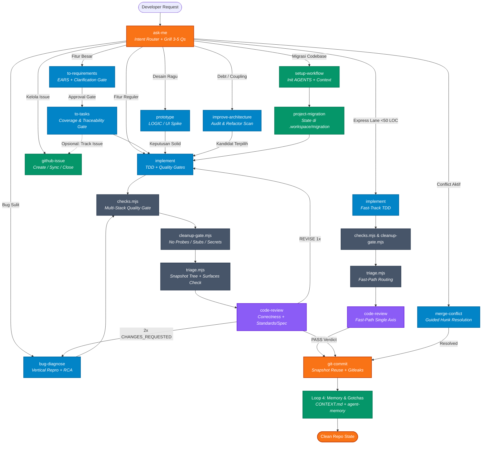

# pi-setup

Personal Pi Coding Agent setup. Instalasi global Pi berada di `~/.pi/agent` (atau `PI_CODING_AGENT_DIR` jika dioverride).

## What's Included

**Extensions (12)**

- `agent-memory` — Injeksi read-only `memory brief` ke system prompt dari vault Obsidian bersama (via skill `agent-memory`)
- `ask-user` — Multiple choice questions for the model
- `code-protection` — Perlindungan keamanan eksekusi dan integritas kode: modul `hash-edit` (anchor SHA-256), `conflict-resolver` (resolusi merge hunk interaktif), `failure-recovery` (eskalasi retry otomatis), dan `ttsr` (Two-Turn System Rules guard & stream interceptor)
- `context-manager` — Session context tracking, large-output caching/pruning, output-frame, dan execute/inspect tools
- `copy-all` — Copy conversation to clipboard
- `git-info` — Git branch, changes, PR status in footer
- `run-summaries` — Auto-summarize agent runs
- `subagents` — Background Pi subagents, workflows, worktrees, dan Agent Control (v2) dengan display name `General`
- `todos` — Todo tracking dengan overlay widget, verifikasi modifikasi kode otomatis via task-judge terintegrasi, dan inactivity nudge
- `ui-customization` — Custom tool rendering (read, bash, edit, write), thinking shimmer, working message, header/footer, dan penyesuaian tema
- `usage-tracker` — Provider quota & session usage dashboard (Claude CLI OAuth, 9Router, Codex, Zen)
- `zenith-router` — Integrasi provider Zenith Router, gateway status reporter, dan publisher quota untuk usage-tracker

> `dashboard-state` adalah modul internal yang dipakai bersama oleh `git-info`, `ui-customization`, dan `usage-tracker` (bukan extension terpisah). Direktori `extensions/ci` berisi runner smoke test CI internal (`runtime-smoke.mjs`).

**Skills (18)**

- `agent-memory` — Memory jangka panjang lintas-agent di vault Obsidian bersama
- `ask-me` — Grill + router (main entry for ambiguous requests)
- `bug-diagnose` — 6-phase disciplined bug diagnosis dengan cleanup gate
- `code-review` — Dual-axis review (Standards + Spec) dengan triage snapshot, fast-path, dan domain surface checklists
- `git-commit` — Conventional commits dengan pre-commit review gate dan snapshot reuse
- `github-issue` — Pembuatan issue GitHub terstruktur dari task, requirement, atau bug diagnosis, serta penutupan/komentar completion gate
- `handoff` — Context handoff between sessions/agents
- `humanize` — Manual-only prose rewrites that preserve meaning
- `implement` — TDD implementation berulang dengan checks gate, cleanup gate, dan code-review chain
- `improve-architecture` — Deepening scan + interview
- `merge-conflict` — Resolusi konflik Git terstruktur dan aman
- `project-migration` — Project migration workflow
- `prompt-authoring` — Panduan menulis teks instruksi untuk LLM: AGENTS.md, SYSTEM.md, SKILL.md, prompt template, deskripsi tool
- `prototype` — Throwaway prototypes (LOGIC/UI)
- `setup-workflow` — Initialize `.workspace/` for project-aware mode
- `status` — Snapshot current workflow state
- `to-requirements` — Synthesize approved requirements into SRS and feature work cards dengan clarification clearance gate
- `to-tasks` — Break approved feature work into vertical-slice tasks dengan traceability & coverage check

**Agents (5)**

Definisi subagent kustom berada di `agents/*.md` (model routing di-pin ke Zenith Router `cc/`):

- `debugger` (`debugger.md`) — Analis Root Cause Analysis (read-only scout) sebagai circuit breaker saat loop build-verify berulang kali gagal atau terjadi bug lintas-modul kompleks (`claude-sonnet-5-5`, tools: `read`, `bash`, `grep`, `find`, `ls`).
- `general` (`general.md`) — Fallback worker untuk tugas ad-hoc lintas-domain yang membutuhkan skills atau tools MCP (`claude-haiku-5-5`, tools: semua, skills: true, extensions: true).
- `planner` (`planner.md`) — Arsitek rencana & kontrak verifikasi (read-only scout) sebelum implementasi; menyusun vertical slices, edge cases, `write_scope`, dan perintah gate (`claude-opus-5-5`).
- `reviewer` (`reviewer.md`) — Auditor diff git (read-only scout) dengan fast-rejection gate bila test/build broken, cross-boundary tracing, dan surface checklists (`UI`, `Database`, `Security`), dilaporkan per keparahan P0-P3 (`claude-haiku-5-5`).
- `verifier` (`verifier.md`) — Eksekutor gate & verifikasi pengujian independen (read-only scout) yang menjalankan test suite, typecheck, lint, dan memverifikasi kriteria penerimaan dengan exit code nyata (`claude-haiku-5-5`).

**Workflows (2)**

Script orkestrasi deterministik di `workflows/*.js`:

- `dev-review-panel.js` — Panel review kode paralel multi-aksis (Correctness/Safety pada `claude-sonnet-5-5` dan Standards/Spec pada `claude-haiku-5-5`) dengan integrasi triage surfaces (`UI`, `Database`, `Security`) dan fase sintesis verdict akhir PASS/FAIL.
- `gated-implement.js` — Loop engineering implementasi otonom: `build` -> deterministic `gate` (`checks.mjs`) -> resume loop terbatas (maksimal 3x) -> fallback eskalasi ke `debugger` untuk RCA bila gagal berulang.

**Subagent Configuration & Presets**

- `subagents.yaml` — Overlay policy per-tipe agent bawaan (`explore` di `claude-haiku-5-5` thinking low max_turns 30; `build` di `claude-sonnet-5-5` thinking medium context isolated workspace worktree max_turns 30; `general` di `claude-haiku-5-5` thinking medium max_turns 20).
- `subagents.json` — Konfigurasi ekstensi global (misal `defaultMaxTurns: 20` dan flag `agentControl`).

**Identity (referensi)**

- `identity/` — Arsip `AGENTS.md` dan `SOUL.md` sebelum digabung. Hanya referensi, tidak ikut dideploy oleh installer.

### Dev Workflow Architecture



#### Komponen Kunci Dev Workflow

1. **Skrip Deterministik (`skills/dev/scripts/`)**:
   - `checks.mjs`: Quality gate deterministik multi-stack (otomatis mendeteksi manifest Node, Dart/Flutter, Python, Go, Rust, PHP, JVM/Android, Ruby, Make/Just, dengan fallback syntax check dan verifikasi `protected_paths`).
   - `triage.mjs`: Analisis diff deterministik sebelum review/commit; merekam snapshot tree (`git write-tree`) dan parents (`HEAD`/`MERGE_HEAD`), mengklasifikasikan `riskTier` (`fast-path` vs `multi-axis`), serta mendeteksi area surface (`UI`, `Database`, `Security`).
   - `context-resolver.mjs`: Resolusi konteks workspace cepat dalam 1 tool call; memeriksa mode (Project vs Universal), bendera stack docs (`hasCodeStyle`, `hasSecurity`, `hasDatabase`, `hasApi`), item antrean work card aktif, serta generator slug branch.
   - `cleanup-gate.mjs`: Pemindaian diff terhadap artefak sisa debugging (`[DEBUG-...]`), placeholder stubs (`TODO: implement`, `throw new Error("Not implemented")`), dan potensi bocoran token/secret.
   - `pre-review-gate.mjs` & `review-preflight.mjs`: Forwarding wrapper untuk kompatibilitas mundur (masing-masing ke `checks.mjs` dan `triage.mjs`).

2. **Express Lane (Daily Fast-Track)**:
   - Jalur cepat untuk modifikasi kecil (`< 50` baris perubahan, non-kritis). Melewati pembuatan artifact formal `.workspace/` dan langsung mengevaluasi diff via `checks.mjs` -> `triage.mjs` (`fast-path`) -> `code-review` ringan -> `git-commit`.

3. **Branch Normalization Convention**:
   - Isolasi branch dan git worktree wajib menggunakan konvensi format bersih: `<type>/<feature-slug>` (misalnya `feat/user-auth`, `fix/login-crash`), bersih dari token nomor internal seperti `F-N` atau `TASK-N`.

4. **Integrasi GitHub Issue (`github-issue`)**:
   - Alur pembuatan issue terstruktur dari requirement/task atau bug diagnosis, pelacakan checkbox task pada issue body saat `implement`, dan completion gate otomatis untuk penutupan atau penambahan komentar rekap saat seluruh task selesai.

5. **Review Escalation & Loop 4**:
   - Bila `code-review` mengembalikan verdict `CHANGES_REQUESTED` 2x berturut-turut pada temuan Correctness/Safety (P0/P1), alur otomatis dieskalasi ke `bug-diagnose` untuk RCA.
   - Setelah commit berhasil, alur Loop 4 mendistilasi gotchas dan aturan baru ke `.workspace/context/CONTEXT.md` dan vault `agent-memory`.

**Themes (4)**

- `catppuccin-mocha` — tema Mocha
- `github-dark-default` — tema GitHub Dark default
- `solar-ignis` — tema charcoal monokrom dengan aksen pastel api solar ignis
- `urple` — varian ungu gelap

`dashboard-state` adalah modul internal yang dipakai bersama oleh `git-info`, `ui-customization`, dan `usage-tracker`; bukan extension user-facing terpisah.

Setup aktif juga memakai extension dan skill eksternal dari Orca (`extensions/orca-*.ts` serta skill seperti `computer-use`, `find-skills`, `orca-cli`, dan `orchestration`). Sumber daya eksternal tersebut dikelola oleh host Orca dan sengaja tidak diikutkan ke repo ini. Memory lintas agent dikelola via vault Obsidian bersama melalui skill `agent-memory`.

## Quick Start

### Windows PowerShell

```powershell
$script = Join-Path $env:TEMP "pi-install.ps1"
Invoke-WebRequest https://raw.githubusercontent.com/Divarizky/pi-setup/main/install.ps1 -OutFile $script
& $script
```

### macOS/Linux

```bash
curl -fsSL https://raw.githubusercontent.com/Divarizky/pi-setup/main/install.sh -o /tmp/pi-install.sh
bash /tmp/pi-install.sh
```

Installer menempatkan resource runtime Pi (`AGENTS.md`, `extensions/`, `agents/`, `prompts/`, `themes/`, dan `node_modules/`) ke root agent Pi dan `skills/` ke `~/.agents/skills/`, tanpa metadata Git atau file setup repository. State pribadi tetap dipertahankan. Skill eksternal lain di `~/.agents/skills/` dan package Pi tambahan dikelola terpisah. Untuk direktori lama, gunakan mode repair di [SETUP.md](SETUP.md).

### Instal manual

```bash
git clone https://github.com/Divarizky/pi-setup.git ~/.pi/agent
cd ~/.pi/agent
npm ci
```

Restart Pi setelah instalasi.

## Project Mode

For persistence across sessions, run `setup-workflow` once per repo:

```
/setup-workflow
```

This creates the current `.workspace/` structure:

- `project-meta.md` — Setup and refresh metadata
- `context/PROJECT.md` — Quick references
- `context/CONTEXT.md` — Domain and technical detail
- `context/SRS.md` — Approved requirements and feature registry
- `context/TRACKER.md` — Feature execution progress
- `work/F-<id>.md` — Per-feature work card

Universal mode works without setup — context stays in chat.

## Extensions Development

Setiap ekstensi di `extensions/` merupakan modul TypeScript mandiri. Lihat `extensions/<name>/` untuk struktur internal masing-masing.

Perintah verifikasi repositori:

- `npm run check`: typecheck seluruh ekstensi (`tsc --noEmit`)
- `npm run check:extensions`: smoke test dan pemeriksaan paket ekstensi
- `npm run test:code-protection`: unit test untuk modul keamanan `code-protection` (`ttsr`, `failure-recovery`, dll.)
- `npm run test:git-info`: unit test untuk `git-info`
- `npm run test:run-summaries`: unit test untuk `run-summaries`
- `npm run test:subagents`: test suite untuk `subagents` (Vitest)
- `npm run test:task-judge`: unit test untuk `task-judge` (di dalam `todos/judge`)
- `npm run test:todos`: unit test terintegrasi untuk `todos` (core, lifecycle, dan judge)
- `npm run test:zenith-router`: unit test untuk `zenith-router`
- `npm run test:ui-customization`: unit test untuk `ui-customization`
- `npm run format:check`: verifikasi format kode via Prettier
- `npm run audit:sessions`: audit baca-saja atas log sesi Pi

`subagents` saat ini versi `2.0.0`, memakai Biome dan Vitest. Perintah utama manajemen subagent adalah `/subagents` dengan agen bawaan `@general`, `@build`, dan `@explore`. Extension yang dikelola Orca (`extensions/orca-*.ts`) dihasilkan oleh host Orca secara dinamis dan diabaikan dari repo ini.
