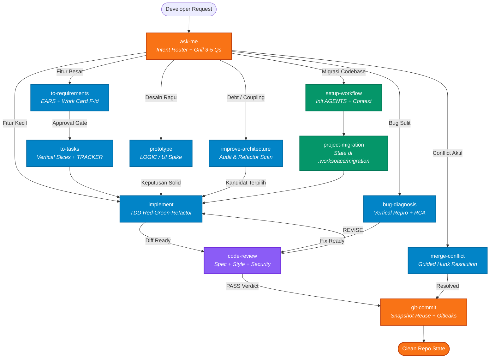

# pi-setup

Personal Pi Coding Agent setup. Instalasi global Pi berada di `~/.pi/agent` (atau `PI_CODING_AGENT_DIR` jika dioverride).

## What's Included

**Extensions (11)**

- `agent-memory` — Injeksi read-only `memory brief` ke system prompt dari vault Obsidian bersama (via skill `agent-memory`)
- `provider-gateway` — Unified provider gateway (9Router, OpenCode Zen, ZenRoute, Claude Pro/Max CLI, Antigravity, OpenAI Codex) dengan auto-deteksi CLI dan dukungan `node:sqlite`
- `ask-user` — Multiple choice questions for the model
- `context-manager` — Session context tracking, large-output caching/pruning, output-frame, dan execute/inspect tools
- `copy-all` — Copy conversation to clipboard
- `git-info` — Git branch, changes, PR status in footer
- `run-summaries` — Auto-summarize agent runs
- `subagents` — Background Pi subagents, workflows, worktrees, dan Agent Control (v2) dengan display name `General`
- `todos` — Todo tracking with overlay widget
- `ui-customization` — Custom tool rendering (read, bash, edit, write), thinking shimmer, working message, header/footer, dan penyesuaian tema
- `usage-tracker` — Provider quota & session usage dashboard (Claude CLI OAuth, 9Router, Codex, Zen)

**Skills (15)**

- `ask-me` — Grill + router (main entry for ambiguous requests)
- `bug-diagnosis` — 6-phase disciplined bug diagnosis
- `code-review` — Dual-axis review (Standards + Spec)
- `git-commit` — Conventional commits with review gate
- `handoff` — Context handoff between sessions/agents
- `humanize` — Manual-only prose rewrites that preserve meaning
- `implement` — TDD implementation with code-review chain
- `improve-architecture` — Deepening scan + interview
- `merge-conflict` — Resolusi konflik Git terstruktur dan aman
- `project-migration` — Project migration workflow
- `prototype` — Throwaway prototypes (LOGIC/UI)
- `setup-workflow` — Initialize `.workspace/` for project-aware mode
- `status` — Snapshot current workflow state
- `to-requirements` — Synthesize approved requirements into SRS and feature work cards
- `to-tasks` — Break approved feature work into vertical-slice tasks

### Dev Workflow Architecture



**Themes (3)**

- `catppuccin-mocha` — tema Mocha
- `github-dark-default` — tema aktif saat ini (lihat `settings.json`)
- `urple` — varian ungu gelap

`dashboard-state` adalah modul internal yang dipakai bersama oleh `git-info`, `ui-customization`, dan `usage-tracker`; bukan extension user-facing terpisah.

Setup aktif juga memakai extension dan skill eksternal dari Orca (`extensions/orca-*.ts` serta skill seperti `computer-use`, `find-skills`, `orca-cli`, dan `orchestration`). Sumber daya eksternal tersebut dikelola oleh host Orca dan sengaja tidak diikutkan ke repo ini. Memory lintas agent dikelola via vault Obsidian bersama melalui skill `agent-memory`.

## Quick Start

### Windows PowerShell

```powershell
$script = Join-Path $env:TEMP "pi-install.ps1"
Invoke-WebRequest https://raw.githubusercontent.com/Divarizky/pi-setup/main/install.ps1 -OutFile $script
& $script
```

### macOS/Linux

```bash
curl -fsSL https://raw.githubusercontent.com/Divarizky/pi-setup/main/install.sh -o /tmp/pi-install.sh
bash /tmp/pi-install.sh
```

Installer menempatkan resource runtime Pi (`extensions/`, `skills/`, `prompts/`, `themes/`, dan `node_modules/`) ke root agent Pi, tanpa metadata Git atau file setup repository. State pribadi tetap dipertahankan. Skill eksternal dari `.agents/skills` dan package Pi tambahan dikelola terpisah. Untuk direktori lama, gunakan mode repair di [SETUP.md](SETUP.md).

### Instal manual

```bash
git clone https://github.com/Divarizky/pi-setup.git ~/.pi/agent
cd ~/.pi/agent
npm ci
```

Restart Pi setelah instalasi.

## Project Mode

For persistence across sessions, run `setup-workflow` once per repo:

```
/setup-workflow
```

This creates the current `.workspace/` structure:

- `project-meta.md` — Setup and refresh metadata
- `context/PROJECT.md` — Quick references
- `context/CONTEXT.md` — Domain and technical detail
- `context/SRS.md` — Approved requirements and feature registry
- `context/TRACKER.md` — Feature execution progress
- `work/F-<id>.md` — Per-feature work card

Universal mode works without setup — context stays in chat.

## Extensions Development

Setiap ekstensi di `extensions/` merupakan modul TypeScript mandiri. Lihat `extensions/<name>/` untuk struktur internal masing-masing.

Perintah verifikasi repositori:

- `npm run check`: typecheck seluruh ekstensi (`tsc --noEmit`)
- `npm run check:extensions`: smoke test dan pemeriksaan paket ekstensi
- `npm run test:subagents`: test suite untuk `subagents` (Vitest)
- `npm run test:ui-customization`: unit test untuk `ui-customization`
- `npm run format:check`: verifikasi format kode via Prettier

`subagents` saat ini versi `2.0.0`, memakai Biome dan Vitest. Perintah utama manajemen subagent adalah `/subagents` dengan agen bawaan `@general`, `@build`, dan `@explore`. Extension yang dikelola Orca (`extensions/orca-*.ts`) dihasilkan oleh host Orca secara dinamis dan diabaikan dari repo ini.
